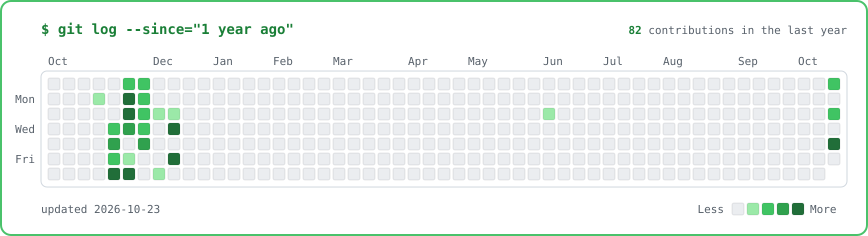
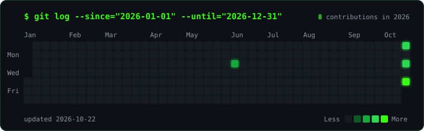
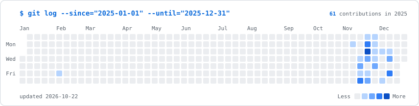

# Guilherme Valença Saunders

**Software Engineer · AI & Machine Learning · Computer Science @ UFPE**

---

### About me

I'm a Computer Science student at the **Federal University of Pernambuco (UFPE)** and **Software Manager at CITi**,
the junior enterprise of UFPE's Informatics Center. My day-to-day sits between writing code and making sure
software projects get delivered to real clients, on time and with quality.

I'm focused on growing as a **software engineer** with depth in **AI engineering and machine learning**:
building systems that are reliable in production, not just in a notebook. On the side, I'm interested in
**quantitative finance** and how data-driven models are used to make decisions.

### Experience

**Software Manager · CITi** (UFPE Informatics Center junior enterprise)

- Coordinate the software team and the delivery of client projects, from scoping to release
- Bridge technical decisions and client needs, keeping scope, deadlines and code quality aligned

 

<!-- heatmap:start -->

<b>2026</b>
 

<b>2025</b>
 

<!-- heatmap:end -->

### Stack

  

